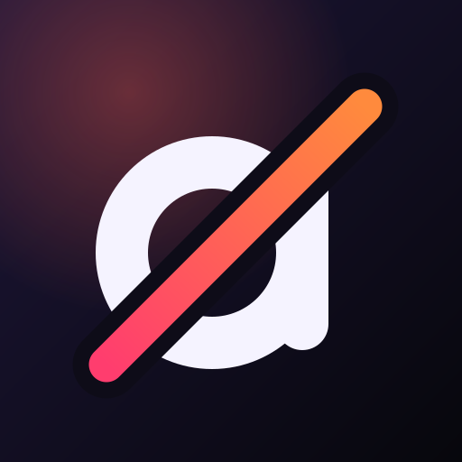

<p align="center"></p>

<h1 align="center">Asocial</h1>

<p align="center"><b>Instagram, YouTube, and Facebook — minus the scroll.</b><br>
Keep your messages, the people you follow, and the things friends send you. Lose Reels, Shorts, Explore, recommended feeds, and ads.</p>

<p align="center"><a href="https://djui.github.io/asocial/">Website</a> · <a href="#build">Build</a> · <a href="#testflight">TestFlight</a></p>

---

Asocial is an iOS app with one tab per site. Each tab is the site's own mobile web app in a web view, with the parts built to keep you scrolling taken out. A reel or short someone sends you still plays — just that one, with nowhere to swipe to.

| | Taken out | Kept |
|---|---|---|
| **Instagram** | Reels tab and feed, Explore grid, suggested posts, sponsored posts | Feed from people you follow, DMs, Stories, profiles, search, posting |
| **YouTube** | Shorts (open as normal videos), Home feed (opens Subscriptions), Up next and end screens, ads | Subscriptions, search, channels, the video you came for |
| **Facebook** | Reels, Video tab, suggested posts and people, sponsored posts, Marketplace | Friends' posts, groups, messages, events, profiles |

Every filter can be switched off on its own in Settings, which also counts what Asocial kept out of your way today.

## Privacy

Asocial has no server, no analytics, and no accounts. Sign-ins live in the system web view's storage on your device, exactly as in Safari; "Sign Out of Everything" in Settings clears them. Links that leave a site open in a Safari sheet.

## How it works

- **Redirects** (`Asocial/Platform.swift`): a filter can send a path somewhere calmer — `/shorts/<id>` becomes `/watch?v=<id>`, Instagram's `/reels/` becomes your inbox. They run twice: in the navigation delegate for page loads, and in the page script for the sites' in-app navigation (`history.pushState`).
- **Selectors**: CSS hidden at document start, scoped to a page with `html[data-asocial-path^="/…"]` where needed.
- **Labels**: exact texts like "Sponsored" or "Suggested for you"; the feed item showing one is hidden as the page renders.
- **Scripts**: small per-filter extras, like skipping a YouTube video ad as soon as it starts.

The sites change their markup often. When something slips through, the fix is usually a new selector or label in `Platform.swift`.

## Build

Needs Xcode 26+ and [XcodeGen](https://github.com/yonaskolb/XcodeGen).

```bash
xcodegen generate
```

```bash
xcodebuild test -project Asocial.xcodeproj -scheme Asocial -destination 'platform=iOS Simulator,name=iPhone 17 Pro'
```

## TestFlight

`scripts/testflight.sh` archives Release and uploads it to App Store Connect with an App Store Connect API key (`TESTFLIGHT_KEY_ID`, `TESTFLIGHT_ISSUER_ID`, and the `.p8` in `~/.appstoreconnect/private_keys/`). The export signs with a cloud-managed distribution certificate and bumps the build number if it's taken.

```bash
scripts/testflight.sh
```

## Credits

Inspired by [SocialLite](https://apps.apple.com/app/id6757661674). Asocial is an independent, from-scratch implementation and isn't affiliated with Instagram, YouTube, Facebook, Meta, or Google. Their names are used only to say which sites the app works with.

MIT licensed.
